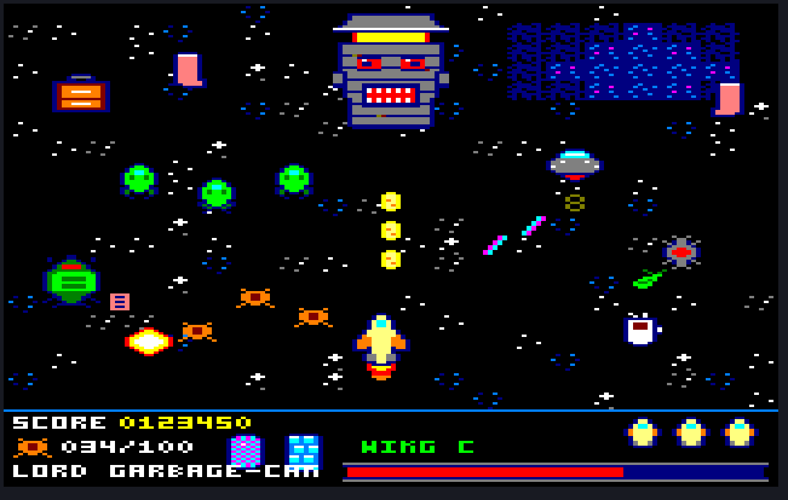

# Space Force C (Amstrad CPC)

Arcade multi-directional scrolling shooter για τον **Amstrad CPC 6128** σε **Mode 0** (160x200, 16 χρώματα), στα 25 FPS με double buffering.

Έτος 2442: οι καλύτεροι πιλότοι της Space Force έχουν δηλητηριαστεί από διαστημικό μουσακά, και η Γη μένει στα χέρια του **Wing C**, της χειρότερης ομάδας της ακαδημίας. Οι Katsarophobians κλέβουν όλα τα μυρμήγκια του πλανήτη για να φτιάξουν Mirmikochai, το τσάι που θα κοιμίσει επιτέλους τον Αυτοκράτορά τους. 8 levels (4 στο διάστημα, 4 στη Γη), το καθένα με τον δικό του boss.

## Κατάσταση

Έχουν γίνει το M0 (build pipeline), το M2 (engine core), το M3
(multi-directional scrolling), το M4 (sprite engine), το M5 (το σκάφος), το
M6 (τα όπλα), το M7 (οι εχθροί και τα όπλα τους), το M8 (power-ups),
το M9 (HUD, τίτλος, redefine keys, high scores), το M10 (μουσική και
ηχητικά εφέ στο AY), το M11 (8 πίστες, συμπιεσμένες στο bank 7, με οθόνες
μετάβασης), το M12 (η πίστα 1 ολόκληρη, με τον boss Lord Garbage-Can), το
M13 (οι πίστες 2-4 με τους bosses τους) και το M14 (οι πίστες 5-8 της Γης).
Το παιχνίδι παίζεται ολόκληρο, και οι 8 πίστες με τους 8 bosses.
Το demo οδηγεί το σκάφος, με αδράνεια και φλόγα εξάτμισης, σε χάρτη 4x2
οθονών με hardware scroll, στα 25 FPS με double buffering, με HUD σε split
screen και 10 εχθρούς με δική τους συμπεριφορά: σχηματισμοί, κύκλοι,
κυνηγητό, νάρκες. Ρίχνουν Laser Spaghetti (επιβραδύνει), έντυπα Ε9 (κολλάνε
στο παρμπρίζ) και τορπίλες που κάνουν zigzag. 3 ζωές, και τα μυρμήγκια που
αφήνουν οι εχθροί σώζονται αν τα αγγίξεις. Πέφτουν και power-ups: Bubble
Wrap, Espresso, Ant-Magnet, Engine, Insecticide, όπλα, ζωή. Τρία όπλα: το Disco-Ray
βάζει τους εχθρούς να χορεύουν Macarena πριν σκάσουν, η μπαγκέτα τους
διαπερνάει, το φτάρνισμα ψεκάζει (με ανάκρουση). Στη Γη το σκάφος αφήνει
καπνό· στις απότομες στροφές οι πιλότοι ουρλιάζουν.
Στον τίτλο: 1 / Fire = παιχνίδι, 2 = redefine keys, 3 = high scores.
Χειρισμός: κέρσορες / joystick, Space / Fire = βολή, W = όπλο, ESC = παύση
(όλα αλλάζουν από το redefine). Για δοκιμή: E = διάστημα/Γη.

- [design_document.md](design_document.md): το game design document
- [todo.md](todo.md): τα milestones της ανάπτυξης
- [assets/README.md](assets/README.md): τα γραφικά, οι αποφάσεις και ο
  μετρημένος προϋπολογισμός του καρέ

## Γραφικά

19,7 KB σε Mode 0: το σκάφος (8 κατευθύνσεις × 2 κόσμοι), 6 εχθροί, 6 όπλα,
9 power-ups, εκρήξεις, 16 πλακίδια φόντου, ο Lord Garbage-Can και
γραμματοσειρά HUD. Όλα παράγονται από ASCII — δες
[assets/README.md](assets/README.md).



```bash
python3 assets/src/make_assets.py
```

Δύο ευρήματα από την τέχνη που αλλάζουν το σχέδιο της μηχανής:

* **Το «24x24 pixels» του σκάφους** βγάζει 48×24 ΜΟΝΑΔΕΣ οθόνης στο Mode 0.
  Ένα σκάφος που στρίβει πρέπει να είναι τετράγωνο στην οθόνη, άρα **12×24
  pixels** — που είναι και 4× φθηνότερο σε blit και σε μνήμη.
* **Ένα πλήρες ξαναζωγράφισμα του φόντου κοστίζει 57,6 ms**, δηλαδή 144 % του
  καρέ των 25 FPS, πριν μπει ένα μόνο sprite. Το M3 δεν είναι επιλογή
  ανάμεσα σε hardware scroll και software redraw: **το software redraw είναι
  ήδη εκτός**.

## Εργαλεία

- [rasm](https://github.com/EdouardBerge/rasm): Z80 assembler
- [iDSK](https://github.com/cpcsdk/idsk): διαχείριση εικόνων δισκέτας (Extended DSK)
- [Caprice32](https://github.com/ColinPitrat/caprice32) και CPCemu: emulators για testing
- Aseprite και Blender: γραφικά (3D μοντέλα που αποδίδονται σε sprites με την παλέτα του CPC)

## Build

```bash
make
```

Βγάζει το `build/SpaceForceC.dsk` (Extended DSK). Στον CPC ή σε emulator: `RUN"DISC`.

| στόχος | τι κάνει |
|---|---|
| `make run` | Caprice32 με τη δισκέτα και autorun |
| `make snap` / `make run-snap` | snapshot (`build/sfc.sna`) που ξεκινάει κατευθείαν |
| `make shot` | Caprice32 χωρίς παράθυρο, γράφει `build/screenshot.png` |
| `make sound` | headless: οι registers του AY γίνονται `build/sound_*.wav` (τίτλος, παιχνίδι, game over) |
| `make START=n` | το παιχνίδι ξεκινάει από την πίστα n, για δοκιμές (μετά ξανά `make` για κανονικό) |
| `make test` | headless CPC (`~/cpcemu`): σενάρια κίνησης, χρόνος καρέ, έλεγχος οθόνης κελί-κελί (`CRTC=0/1/2` για τύπο CRTC) |
| `make run-cpcemu` | CPCEMU 2.5 για Linux (`CPCEMU_TGZ=` το tarball από το cpc-emu.org) |
| `make PROFILE=1 ...` | raster bars στο border: ο χρόνος κάθε φάσης του καρέ |
| `make assets` | ξαναπαράγει τα `assets/data` από τα `assets/src` |

Το Caprice32 είναι το snap package. Καλείται μέσω του `tools/cap32.sh`, γιατί ο `caprice32.launcher` πετάει τις επιλογές της γραμμής εντολών.
