# Space Force C

*Εγχειρίδιο παίκτη. Arcade shooter για τον Amstrad CPC.*

[English](manual-en.md)

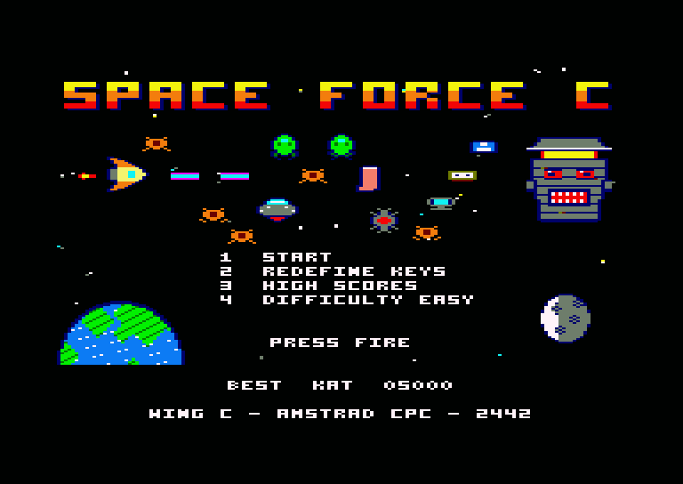

## Περιεχόμενα

- [Η ιστορία](#η-ιστορία)
- [Τι χρειάζεσαι](#τι-χρειάζεσαι)
- [Φόρτωμα](#φόρτωμα)
- [Το κύριο μενού](#το-κύριο-μενού)
- [Χειρισμός](#χειρισμός)
- [Η οθόνη](#η-οθόνη)
- [Πώς παίζεται μια πίστα](#πώς-παίζεται-μια-πίστα)
- [Ενέργεια και ζωές](#ενέργεια-και-ζωές)
- [Τα όπλα σου](#τα-όπλα-σου)
- [Power-ups](#power-ups)
- [Οι εχθροί](#οι-εχθροί)
- [Με τι σε χτυπούν](#με-τι-σε-χτυπούν)
- [Οι οκτώ πίστες](#οι-οκτώ-πίστες)
- [Σκορ](#σκορ)
- [Συμβουλές](#συμβουλές)
- [Credits](#credits)

## Η ιστορία

Έτος 2442. Η Space Force είναι η κοσμική άμυνα της ανθρωπότητας, όμως οι καλύτεροι πιλότοι της έχουν αναρρωτική μετά από ομαδική δηλητηρίαση με χαλασμένο διαστημικό μουσακά. Η ασφάλεια της Γης πέφτει στα χέρια του **Wing C**, της ομάδας με τη χαμηλότερη βαθμολογία στην ακαδημία. Πέρασαν τη ναυσιπλοΐα με οριακό 5 στα 10 και ακόμα μπερδεύουν το warp drive με την καφετιέρα.

Οι εισβολείς είναι οι **Katsarophobians** και θέλουν ένα μόνο πράγμα: όλα τα μυρμήγκια της Γης. Ο Αυτοκράτοράς τους υποφέρει από ανίατη αϋπνία και μόνο το *Mirmikochai*, ένα τσάι από μυρμήγκια και γαλαξιακό κακάο, μπορεί να τον κοιμίσει. Χωρίς αυτό απειλεί να καταστρέψει το σύμπαν, γιατί του έχουν σπάσει τα νεύρα.

Πετάς με το σκάφος του Wing C, το **The Flying Patates**. Σταμάτα τους εισβολείς και φέρε πίσω τα μυρμήγκια.

## Τι χρειάζεσαι

- Έναν **Amstrad CPC 6128**, ή CPC 464 ή 664 με 128K μνήμη και μονάδα δισκέτας
- Έγχρωμη οθόνη
- Το joystick είναι προαιρετικό. Όλο το παιχνίδι παίζεται και με το πληκτρολόγιο

Το παιχνίδι έχει δοκιμαστεί στον emulator Caprice32, όχι ακόμα σε πραγματικό CPC.

## Φόρτωμα

Βάλε τη δισκέτα και γράψε:

    RUN"DISC

Η οθόνη του REVIVE8BIT μένει δέκα δευτερόλεπτα. Με το **SPACE** την προσπερνάς. Μετά το παιχνίδι φορτώνει και ξεκινά από την οθόνη τίτλου.

## Το κύριο μενού

| Πλήκτρο | Τι κάνει |
|---|---|
| **1** ή Fire | Ξεκινά νέο παιχνίδι |
| **2** | Αλλάζει τα πλήκτρα |
| **3** | Δείχνει τα ρεκόρ |
| **4** | Αλλάζει τη δυσκολία |

Η δυσκολία ορίζει πόσα χτυπήματα αντέχει μια ζωή:

| Δυσκολία | Χτυπήματα ανά ζωή |
|---|---|
| Easy | 10 |
| Medium | 5 |
| Hard | 2 |

Στις οθόνες της ιστορίας, το Fire πηγαίνει στην επόμενη οθόνη και το ESC προσπερνά τη σκηνή.

## Χειρισμός

| Ενέργεια | Πληκτρολόγιο | Joystick |
|---|---|---|
| Κίνηση σε 8 κατευθύνσεις | Κέρσορες | Μοχλός |
| Βολή | SPACE | Οποιοδήποτε κουμπί fire |
| Επόμενο όπλο | W | (από το πληκτρολόγιο) |
| Παύση | ESC | (από το πληκτρολόγιο) |

Με την επιλογή 2 του μενού διαλέγεις δικά σου πλήκτρα και για τις επτά ενέργειες. Το joystick δουλεύει πάντα, όποια πλήκτρα κι αν διαλέξεις.

Το σκάφος έχει αδράνεια: επιταχύνει και φρενάρει σταδιακά, και ρίχνει πάντα προς την κατεύθυνση που κοιτάζει.

## Η οθόνη

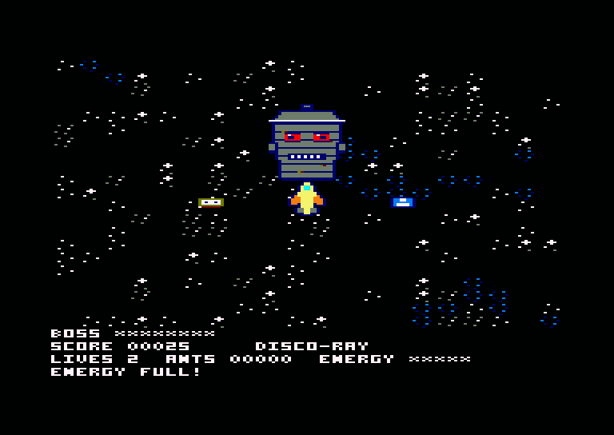

Οι ενδείξεις στο κάτω μέρος δείχνουν:

- **BOSS**: την αντοχή του boss, όσο κρατά η μάχη
- **SCORE**: τους πόντους σου, δίπλα στο όνομα του όπλου που έχεις
- **LIVES**: τις ζωές που σου μένουν
- **ANTS**: τα μυρμήγκια που έχεις σώσει
- **ENERGY**: πόσα χτυπήματα αντέχει ακόμα η τωρινή ζωή
- Η τελευταία γραμμή δείχνει σύντομα μηνύματα, όπως `ENERGY FULL!`

## Πώς παίζεται μια πίστα

Κάθε πίστα είναι ένας μεγάλος χάρτης που κυλά προς όλες τις κατευθύνσεις. Μια συγκεκριμένη λίστα εχθρών έρχεται εναντίον σου, λίγοι λίγοι. Όταν τελειώσει η λίστα, έρχεται ο boss της πίστας. Αν τον νικήσεις, περνάς στην επόμενη.

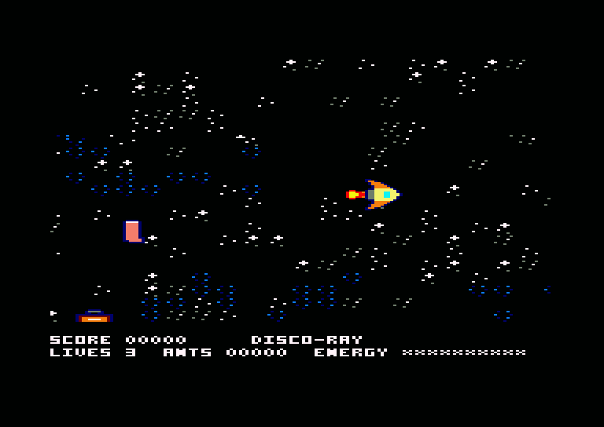

Τα όπλα και οι αναβαθμίσεις κινητήρα περνούν από πίστα σε πίστα και μένουν ως το τέλος του παιχνιδιού.

## Ενέργεια και ζωές

Ξεκινάς με **3 ζωές**. Κάθε χτύπημα σου παίρνει μία μονάδα ενέργειας. Μετά το σκάφος αναβοσβήνει και για 1 δευτερόλεπτο δεν χτυπιέται.

Όταν η ενέργεια μηδενιστεί, χάνεις μια ζωή. Η ενέργεια γεμίζει ξανά και έχεις 2 δευτερόλεπτα ασφάλειας. Όταν τελειώσουν οι ζωές, το παιχνίδι τελειώνει.

Ενέργεια κοστίζουν:

- Η επαφή με εχθρό. Ο εχθρός σκάει, εκτός αν είναι boss
- Η Bad Breath Torpedo
- Ό,τι πετάει ένας boss

Οι μπαταρίες που αφήνουν οι εχθροί γεμίζουν την ενέργεια. Έξτρα ζωές παίρνεις από το power-up Extra Life και κάθε 15.000 πόντους.

## Τα όπλα σου

Με το **W** αλλάζεις ανάμεσα στα τρία όπλα. Ξεκινάς με το Disco-Ray.

| | Όπλο | Τι κάνει |
|---|---|---|
| 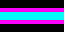 | **Disco-Ray** | Γρήγορη δέσμη από νέον. Ο εχθρός που χτυπά χορεύει Macarena για ένα δευτερόλεπτο και μετά σκάει από την ντροπή του. |
| 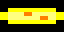 | **Mega-Baguette** | Ρίχνει πιο αργά, αλλά η μπαγιάτικη μπαγκέτα περνά μέσα από τους εχθρούς και συνεχίζει. Οι αναβαθμίσεις δίνουν δύο και μετά τρεις μπαγκέτες σε βεντάλια. |
| 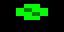 | **Sneeze Cannon** | Πολύ γρήγορος ψεκασμός με πράσινα σωματίδια και μικρό βεληνεκές. Η ανάκρουση σπρώχνει το σκάφος προς τα πίσω. |

## Power-ups

Όταν σκάσει ένας εχθρός, αφήνει τα κλεμμένα μυρμήγκια του. Ένας στους τέσσερις αφήνει και power-up, ενώ ο Roach Commander αφήνει πάντα. Όλα αναβοσβήνουν και χάνονται σε **10 δευτερόλεπτα**, οπότε βιάσου.

| | Αντικείμενο | Τι κάνει |
|---|---|---|
| 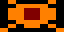 | **Μυρμήγκι** | 50 πόντοι, και μετράει στο ANTS |
| 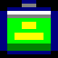 | **Energy** | Γεμίζει την ενέργεια |
| 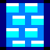 | **Shield Bubble Wrap** | Απορροφά το επόμενο χτύπημα με ένα ικανοποιητικό POP |
| 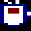 | **Espresso Boost** | 10 δευτερόλεπτα με μιάμιση φορά την ταχύτητά σου. Οι πιλότοι ουρλιάζουν και τρεις φορές πιο γρήγορα |
| 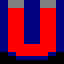 | **Ant-Magnet** | Για 10 δευτερόλεπτα τα μυρμήγκια έρχονται μόνα τους |
| 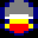 | **Engine** | Μόνιμη αύξηση ταχύτητας 25%, έως δύο φορές |
| 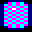 | **Disco-Ray** | Σου δίνει αυτό το όπλο |
| 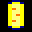 | **Mega-Baguette** | Σου δίνει αυτό το όπλο. Αν το έχεις ήδη, ανεβαίνει επίπεδο, έως τρεις μπαγκέτες |
| 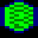 | **Sneeze Cannon** | Σου δίνει αυτό το όπλο |
| 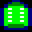 | **Insecticide** | Για 10 δευτερόλεπτα το σκάφος ψεκάζει μόνο του σε κύκλο |
| 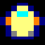 | **Extra Life** | Μία ζωή ακόμα |

## Οι εχθροί

| | Εχθρός | Χτυπήματα | Πώς φέρεται | Μυρμήγκια |
|---|---|---|---|---|
| 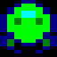 | **Katsarophobian** | 1 | Πετά σε σχηματισμούς των τριών και ρίχνει Bureaucracy Beam | 1 |
| 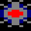 | **Νάρκη** | 1 | Μένει ακίνητη και σκάει όταν την αγγίξεις | 0 |
| 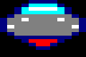 | **Δίσκος** | 2 | Πετά σε κύκλους και ρίχνει Laser Spaghetti | 1 |
| 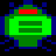 | **Roach Commander** | 3 | Σε κυνηγά και ρίχνει Bad Breath Torpedo. Αφήνει πάντα power-up | 2 |
| 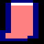 | **Κάλτσα** | 1 | Αναπηδά στον χάρτη | 1 |
| 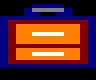 | **Βαλίτσα** | 3 | Αναπηδά στον χάρτη | 1 |

Στη Γη, άλλα πράγματα παίρνουν τη θέση της κάλτσας και της βαλίτσας, με την ίδια συμπεριφορά:

| Πίστα | Αντί για κάλτσα | Αντί για βαλίτσα |
|---|---|---|
| 5 | Κώνος κυκλοφορίας | Ιπτάμενο αυτοκίνητο |
| 6 | Σκαθάρι | Γιγάντιο μυρμήγκι |
| 7 | Τουρίστας | Τουριστικό λεωφορείο |
| 8 | Τηγάνι | Κατσαρόλα |

Οι εχθροί ρίχνουν πιο γρήγορα σε κάθε πίστα.

## Με τι σε χτυπούν

| | Όπλο | Τι κάνει |
|---|---|---|
|  | **Bureaucracy Beam** | Ένα έντυπο Ε9 κολλά στο παρμπρίζ για 2 δευτερόλεπτα και κρύβει το σκάφος. Δεν χάνεις ενέργεια, αλλά πετάς στα τυφλά |
| 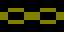 | **Laser Spaghetti** | Τυλίγει το σκάφος και κόβει την ταχύτητα στη μισή για 3 δευτερόλεπτα. Δεν χάνεις ενέργεια |
| 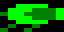 | **Bad Breath Torpedo** | Έρχεται με ζιγκ-ζαγκ και κοστίζει ενέργεια |

## Οι οκτώ πίστες

### Μέρος Α: Διάστημα

| | Πίστα | Boss | Αντοχή boss |
|---|---|---|---|
| 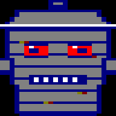 | **1. The Asteroid Belt of Lost Luggage** (η ζώνη των χαμένων αποσκευών) | Ο Lord Garbage-Can πετά παλιό hardware του Amstrad | 120 |
| 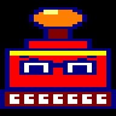 | **2. The Nebula of Bureaucracy** (το νεφέλωμα της γραφειοκρατίας) | Ο Grand Inspector είναι μια γιγάντια ιπτάμενη σφραγίδα | 140 |
| 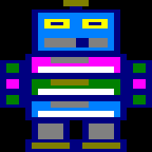 | **3. Trashcan City of the Galaxy** (η πόλη-σκουπιδοτενεκές του γαλαξία) | Το Mecha-Trashcan 3000 είναι ρομπότ από παλιές δισκέτες | 170 |
| 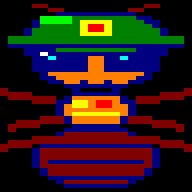 | **4. The Lunar Ant-Hill** (η σεληνιακή μυρμηγκοφωλιά) | Ο General Formix είναι μυρμήγκι με κράνος και γυαλιά ηλίου | 200 |

### Μέρος Β: Γη

| | Πίστα | Boss | Αντοχή boss |
|---|---|---|---|
| 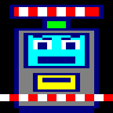 | **5. Traffic on Attiki Odos** (κίνηση στην Αττική Οδό) | Το Undefeated Toll Booth εκτοξεύει μπάρες διοδίων | 150 |
| 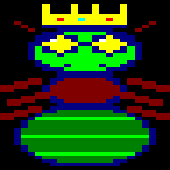 | **6. The Underground Tunnels of Megara** (οι υπόγειες σήραγγες των Μεγάρων) | Η Queen Ant-Zilla γιγάντωσε με ραδιενεργό τσάι | 180 |
| 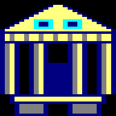 | **7. The Acropolis Parking Lot** (το πάρκινγκ της Ακρόπολης) | Το Parthenon-Bot 2.0 είναι ναός που έγινε ρομπότ | 210 |
| 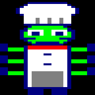 | **8. The Kitchen of the Mothership** (η κουζίνα του μητρικού σκάφους) | Ο Chef Xylokorinthos έχει έξι χέρια και πετά καυτή σούπα | 240 |

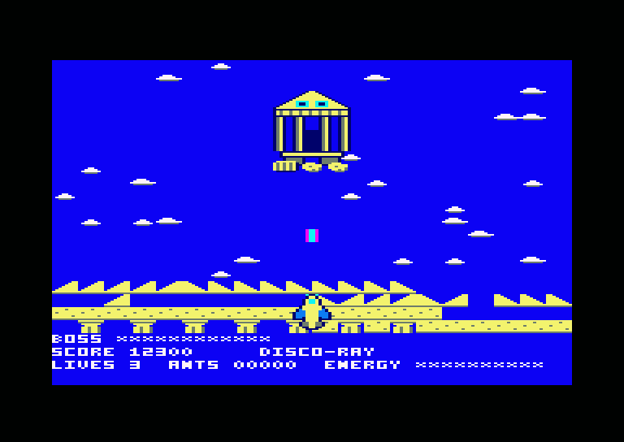

Κάθε boss αλλάζει όψη λίγο πριν ρίξει. Κάτω από τη μισή αντοχή ρίχνει πιο συχνά, και μέσα στη μάχη αφήνει μία μπαταρία.

## Σκορ

| Γεγονός | Πόντοι |
|---|---|
| Εχθρός που καταστράφηκε | 50 |
| Μυρμήγκι που μαζεύτηκε | 50 |
| Power-up που μαζεύτηκε | 25 |
| Boss που νικήθηκε | 2.000 |
| Κάθε 15.000 πόντοι | Μία έξτρα ζωή |

Το σκορ σταματά στους 65.535 πόντους. Τα πέντε καλύτερα σκορ μπαίνουν στον πίνακα ρεκόρ. Για το όνομά σου, το πάνω και το κάτω αλλάζουν το γράμμα και το Fire πηγαίνει στο επόμενο. Ο πίνακας δεν αποθηκεύεται στη δισκέτα, οπότε ξεκινά από την αρχή κάθε φορά που φορτώνεις το παιχνίδι.

## Συμβουλές

- Μένε σε κίνηση, αλλά μην πέφτεις με φόρα σε πλήθος εχθρών: το σκάφος θέλει χρόνο για να σταματήσει.
- Μάζευε γρήγορα τα μυρμήγκια. Αξίζουν όσο ο εχθρός που τα άφησε και χάνονται σε 10 δευτερόλεπτα.
- Χρησιμοποίησε τη Mega-Baguette όταν οι εχθροί είναι στη σειρά, γιατί περνά μέσα από όλους.
- Το Sneeze Cannon θέλει να είσαι κοντά, και πρόσεχε την ανάκρουση δίπλα σε boss.
- Όταν ένα Ε9 κρύβει το σκάφος, μείνε μακριά από εχθρούς ώσπου να πέσει.
- Στον boss, απομακρύνσου από τη βεντάλια των βολών αντί να περνάς μέσα της.

## Credits

REVIVE8BIT - 2026 - VASPER
