# Space Force C

*Player's manual. An arcade shooter for the Amstrad CPC.*

[Ελληνικά](manual-el.md)

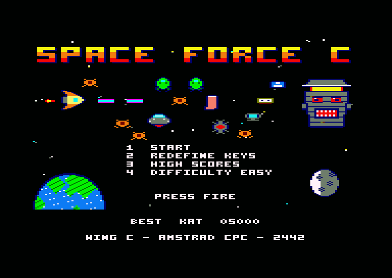

## Contents

- [The story](#the-story)
- [What you need](#what-you-need)
- [Loading the game](#loading-the-game)
- [The main menu](#the-main-menu)
- [Controls](#controls)
- [The screen](#the-screen)
- [How a level works](#how-a-level-works)
- [Energy and lives](#energy-and-lives)
- [Your weapons](#your-weapons)
- [Power-ups](#power-ups)
- [The enemies](#the-enemies)
- [What they shoot at you](#what-they-shoot-at-you)
- [The eight levels](#the-eight-levels)
- [Score](#score)
- [Tips](#tips)
- [Credits](#credits)

## The story

The year is 2442. The Space Force is humanity's cosmic defence, but its best pilots are on sick leave after a mass poisoning by bad space moussaka. Earth's safety falls to **Wing C**, the team with the lowest score at the space academy. They passed navigation with a borderline 5 out of 10 and still confuse the warp drive with the coffee maker.

The invaders are the **Katsarophobians**, and they want one thing: all the ants on Earth. Their Emperor suffers from incurable insomnia, and only *Mirmikochai*, a tea brewed from ants and galactic cocoa, can put him to sleep. Without it he threatens to destroy the universe because his nerves are acting up.

You fly Wing C's ship, **The Flying Patates**. Stop the invaders, and bring back the ants.

## What you need

- An **Amstrad CPC 6128**, or a CPC 464 or 664 with 128K of memory and a disc drive
- A colour monitor
- A joystick is optional. The keyboard plays the whole game

The game has been tested on the Caprice32 emulator, but not yet on a real CPC.

## Loading the game

Insert the disc and type:

    RUN"DISC

The REVIVE8BIT screen appears for ten seconds. Press **SPACE** to skip it. The game then loads and starts at the title screen.

## The main menu

| Key | What it does |
|---|---|
| **1** or Fire | Starts a new game |
| **2** | Redefines the keys |
| **3** | Shows the high scores |
| **4** | Changes the difficulty |

Difficulty sets how many hits one life can take:

| Difficulty | Hits per life |
|---|---|
| Easy | 10 |
| Medium | 5 |
| Hard | 2 |

During the story screens, Fire moves on to the next screen and ESC skips the scene.

## Controls

| Action | Keyboard | Joystick |
|---|---|---|
| Move in 8 directions | Cursor keys | Stick |
| Fire | SPACE | Either fire button |
| Next weapon | W | (use the keyboard) |
| Pause | ESC | (use the keyboard) |

Option 2 in the menu lets you choose your own keys for all seven actions. The joystick always works, whatever keys you choose.

The ship has inertia: it speeds up and slows down gradually, and it always fires in the direction it is facing.

## The screen

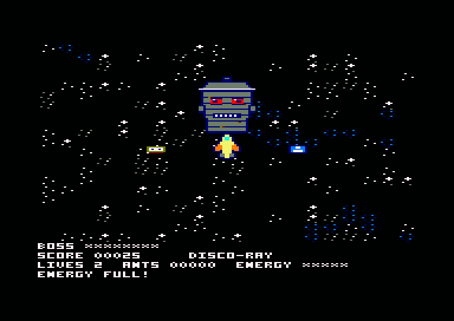

The panel at the bottom shows:

- **BOSS**: the strength of the boss, during a boss fight
- **SCORE**: your points, next to the name of your current weapon
- **LIVES**: the lives you have left
- **ANTS**: the ants you have saved
- **ENERGY**: the hits your current life can still take
- The bottom line shows short messages, such as `ENERGY FULL!`

## How a level works

Each level is a large map that scrolls in every direction. A set list of enemies comes at you, a few at a time. When the list runs out, the level's boss arrives. Beat the boss and you move on to the next level.

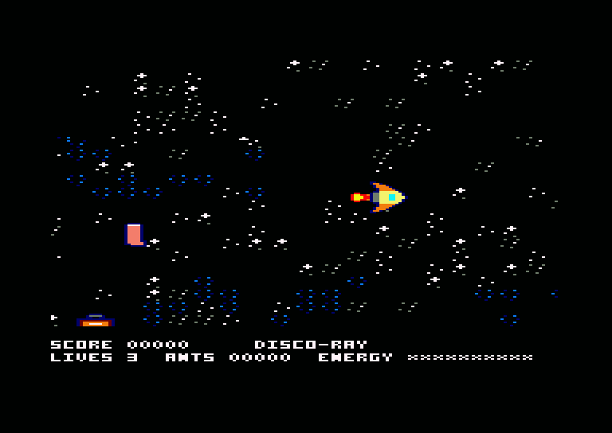

Your weapons and engine upgrades carry over from one level to the next. They last until the game ends.

## Energy and lives

You start with **3 lives**. Each hit takes one point of energy, and the ship then blinks and cannot be hit for 1 second.

When your energy reaches zero you lose a life. Your energy fills up again and you get 2 seconds of safety. When you run out of lives, the game is over.

These things cost energy:

- Touching an enemy. The enemy explodes, unless it is a boss
- A Bad Breath Torpedo
- Anything a boss throws at you

The batteries that enemies drop refill your energy. You get extra lives from the Extra Life power-up and from every 15,000 points.

## Your weapons

Press **W** to switch between the three weapons. You start with the Disco-Ray.

| | Weapon | What it does |
|---|---|---|
| 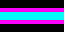 | **Disco-Ray** | A fast beam of neon light. An enemy it hits dances the Macarena for a second, then explodes from embarrassment. |
| 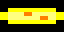 | **Mega-Baguette** | Fires more slowly, but a stale baguette goes straight through enemies and keeps flying. Upgrades give you two, then three baguettes in a fan. |
| 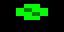 | **Sneeze Cannon** | A very rapid spray of green particles with a short range. The recoil pushes the ship backwards. |

## Power-ups

When an enemy explodes it leaves its stolen ants behind. One enemy in four also drops a power-up, and a Roach Commander always does. Everything they drop flashes and disappears after **10 seconds**, so hurry.

| | Item | What it does |
|---|---|---|
|  | **Ant** | 50 points, and it counts towards ANTS |
| 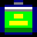 | **Energy** | Refills your energy |
| 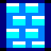 | **Shield Bubble Wrap** | Absorbs the next hit with a satisfying POP |
| 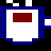 | **Espresso Boost** | 10 seconds at one and a half times your speed. The pilots also scream three times faster |
| 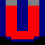 | **Ant-Magnet** | For 10 seconds, ants fly to you on their own |
| 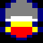 | **Engine** | A permanent speed increase of 25%, up to twice |
| 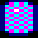 | **Disco-Ray** | Switches to this weapon |
| 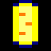 | **Mega-Baguette** | Switches to this weapon. If you already have it, it gains a level, up to three baguettes |
| 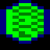 | **Sneeze Cannon** | Switches to this weapon |
| 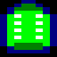 | **Insecticide** | For 10 seconds, the ship automatically sprays in a circle |
| 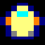 | **Extra Life** | One more life |

## The enemies

| | Enemy | Hits | How it behaves | Ants |
|---|---|---|---|---|
| 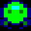 | **Katsarophobian** | 1 | Flies in formations of three and fires Bureaucracy Beams | 1 |
| 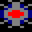 | **Mine** | 1 | Stays still and explodes when you touch it | 0 |
| 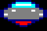 | **Saucer** | 2 | Flies in circles and fires Laser Spaghetti | 1 |
| 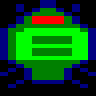 | **Roach Commander** | 3 | Chases you and fires Bad Breath Torpedoes. It always drops a power-up | 2 |
| 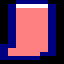 | **Sock** | 1 | Bounces around the map | 1 |
| 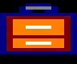 | **Suitcase** | 3 | Bounces around the map | 1 |

On Earth, other things take the place of the sock and the suitcase, and they behave the same way:

| Level | Instead of the sock | Instead of the suitcase |
|---|---|---|
| 5 | Traffic cone | Flying car |
| 6 | Beetle | Giant ant |
| 7 | Tourist | Tour bus |
| 8 | Frying pan | Soup pot |

Enemies fire faster with every level.

## What they shoot at you

| | Weapon | What it does |
|---|---|---|
|  | **Bureaucracy Beam** | An E9 tax form sticks to your windscreen for 2 seconds and hides the ship. No energy lost, but you are flying blind |
|  | **Laser Spaghetti** | Wraps around the ship and halves your speed for 3 seconds. No energy lost |
| 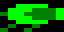 | **Bad Breath Torpedo** | Zigzags towards you and costs energy |

## The eight levels

### Part A: Space

| | Level | Boss | Boss's strength |
|---|---|---|---|
| 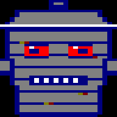 | **1. The Asteroid Belt of Lost Luggage** | Lord Garbage-Can throws old Amstrad hardware | 120 |
| 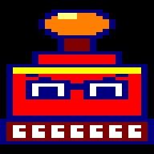 | **2. The Nebula of Bureaucracy** | The Grand Inspector is a giant flying stamp | 140 |
| 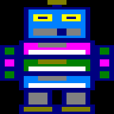 | **3. Trashcan City of the Galaxy** | Mecha-Trashcan 3000 is a robot made of old floppy discs | 170 |
| 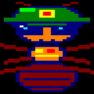 | **4. The Lunar Ant-Hill** | General Formix is an ant in a helmet and sunglasses | 200 |

### Part B: Earth

| | Level | Boss | Boss's strength |
|---|---|---|---|
| 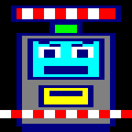 | **5. Traffic on Attiki Odos** | The Undefeated Toll Booth launches safety barriers | 150 |
| 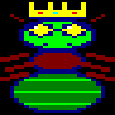 | **6. The Underground Tunnels of Megara** | Queen Ant-Zilla grew huge on radioactive tea | 180 |
| 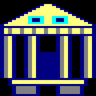 | **7. The Acropolis Parking Lot** | Parthenon-Bot 2.0 is a temple that turned into a robot | 210 |
| 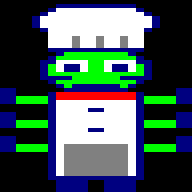 | **8. The Kitchen of the Mothership** | Chef Xylokorinthos has six arms and throws hot soup | 240 |

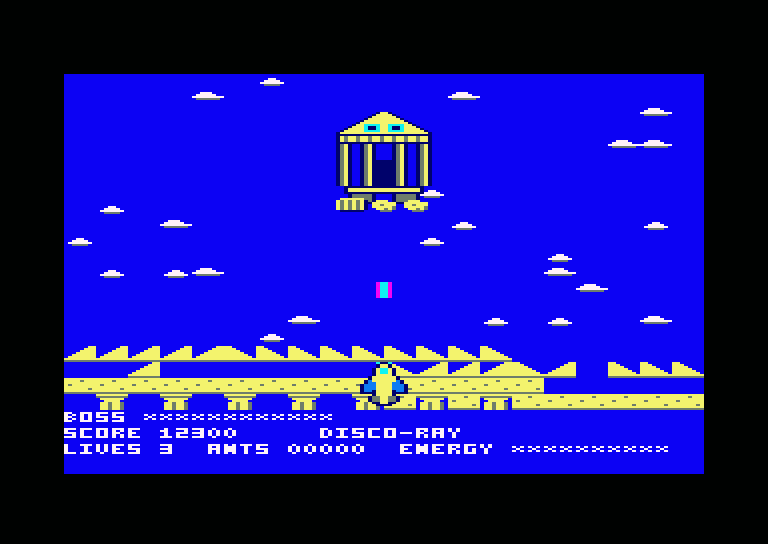

Every boss has a warning frame just before it fires. Below half strength it fires more often, and it drops one battery during the fight.

## Score

| Event | Points |
|---|---|
| Enemy destroyed | 50 |
| Ant collected | 50 |
| Power-up collected | 25 |
| Boss defeated | 2,000 |
| Every 15,000 points | One extra life |

The score stops at 65,535. The five best scores go on the high score table. To enter your name, use Up and Down to change the letter and Fire to go to the next one. The table is not saved to disc, so it starts afresh each time you load the game.

## Tips

- Keep moving, and do not fly into a crowd at full speed: the ship takes time to stop.
- Collect ants quickly. They are worth as much as the enemy that dropped them, and they vanish after 10 seconds.
- Use the Mega-Baguette when enemies line up, because it goes through all of them.
- Use the Sneeze Cannon only up close, and remember the recoil near a boss.
- When an E9 form hides your ship, stay away from enemies until it falls off.
- Against a boss, back away from its fan of shots rather than flying through it.

## Credits

REVIVE8BIT - 2026 - VASPER
